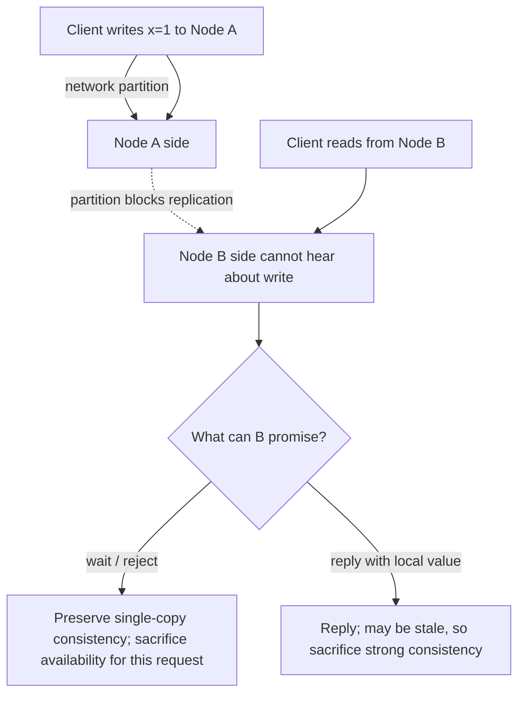

# CAP Theorem

CAP describes a limit on a distributed data system **when a network partition occurs**. A partition means nodes cannot reliably communicate across some part of the network.

- **Consistency (C):** in CAP, this means an operation behaves as if there were one up-to-date copy of the data (linearizability), not every meaning of consistency used in databases.
- **Availability (A):** every request received by a non-failing node gets a non-error response, even if that response may not contain the newest write.
- **Partition tolerance (P):** the system continues operating despite communication being lost between parts of the cluster.

## The useful interpretation

In a networked distributed system, a partition is a failure the design must handle. During a partition, a system cannot guarantee both CAP consistency and CAP availability for every operation. It must choose behavior for affected requests: wait or reject some operations to preserve the single-copy guarantee, or respond from reachable state with the possibility of stale or conflicting data.

This does **not** mean every database is simply “CP” or “AP” in every situation, or that consistency and availability are always opposing choices. Without a partition, the CAP tradeoff is not the decision being forced. Real systems can make different choices by operation, data, and failure mode. Also distinguish CAP consistency from broader notions such as eventual consistency and transactional isolation.

## AI engineering connection

A vector index replicated across regions may be reachable during a network partition while having different document versions. For a retrieval request, decide whether serving slightly stale results is acceptable or whether the system should fail closed until it can confirm freshness. The answer depends on the product: low-risk discovery may tolerate staleness; access-control changes should not.

## Practice

Suppose a document is deleted for privacy reasons, but one search replica is partitioned and still has its embedding. Decide whether that replica may return a result. State the consistency and availability behavior you choose and how you recover after the partition.

## References

- Martin Kleppmann, *Designing Data-Intensive Applications*, Chapter 8, “The Trouble with Distributed Systems,” and Chapter 9, “Consistency and Consensus.”
- [NeetCode — System Design concepts](https://blog.neetcode.io/p/system-design-concepts-know).
- [Hello Interview — CAP Theorem](https://www.hellointerview.com/learn/system-design/core-concepts/cap-theorem) (see the Core Concepts section).

