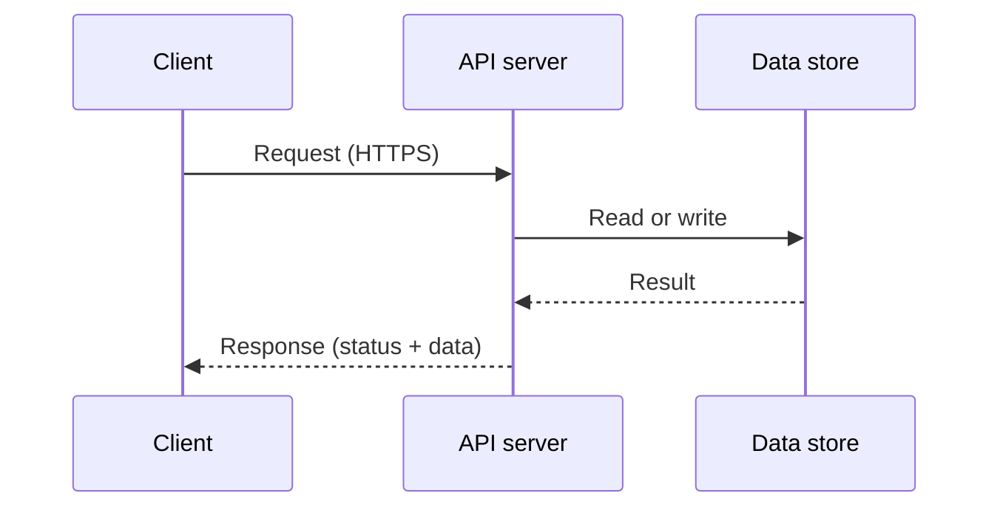

# Client–Server Architecture

Client–server is a way to divide work across a request boundary. A client asks for a service; a server receives the request, performs or coordinates the work, and returns a response. The client might be a browser, mobile app, another backend, or a device. The server may be one process or a larger system hidden behind an API.

## What the boundary gives you

- **Independent responsibilities:** the client handles presentation and user interaction; the server enforces application rules and coordinates shared data.
- **A network contract:** clients and servers can evolve independently when the API contract stays compatible.
- **Centralized control of shared resources:** authorization, validation, and writes to shared state can be enforced server-side.

The network is part of the design. Requests can be delayed, duplicated by retries, or fail after the server has already completed the operation. Use timeouts; make retry behavior safe for the operation; and avoid trusting client input for authorization or data integrity.

## Stateful and stateless servers

A stateless request handler can process a request using its input and shared services without depending on memory from an earlier request. This makes it easier to add or replace instances. User sessions and other durable state can live in a database or a dedicated session store. Stateless does not mean the whole system has no state.

## AI engineering connection

A model-serving API often sits between a client and several dependencies: authentication, a prompt or feature builder, a model endpoint, and sometimes retrieval. Expose stable request/response contracts, enforce limits at the server, and set separate timeouts for model and retrieval calls. Streaming tokens changes how the response is delivered, but the client–server contract still needs cancellation, errors, and completion semantics.

## Practice

Draw the request path for a client that sends a question and receives an answer with source citations. Mark the trust boundary and identify which component checks access to each document.

## References

- Martin Kleppmann, *Designing Data-Intensive Applications*, Chapter 4, “Encoding and Evolution” (dataflow through services and message-passing dataflow).
- [Hello Interview — Introduction](https://www.hellointerview.com/learn/system-design/in-a-hurry/introduction).
