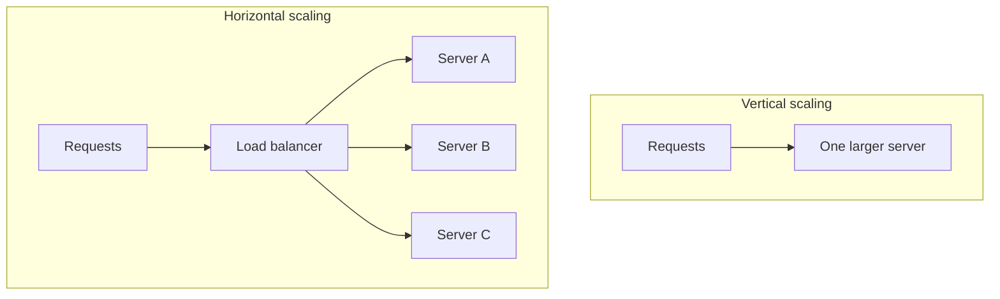

# Horizontal vs. Vertical Scaling

**Vertical scaling (scale up)** gives one machine more resources, such as CPU, memory, or storage. **Horizontal scaling (scale out)** adds machines and distributes requests or data across them.

## Choose based on the bottleneck

| Scale up | Scale out |
|---|---|
| Often the simplest first response to resource pressure | Adds capacity by distributing work |
| Fewer coordination and routing concerns | Can improve capacity and failure isolation |
| Has machine, cost, and provider limits; can leave a larger failure domain | Requires routing, coordination, and sometimes partitioning or replication |

Scaling out is not a single switch. Stateless request handlers can often be replicated behind a load balancer. Stateful systems must decide where data lives, how replicas stay consistent, and how work is routed. Measure the bottleneck first: adding application servers will not fix a saturated database or a slow external model API.

## AI engineering connection

Inference may be limited by GPU memory, accelerator availability, or model latency. Replicating model servers can increase parallel capacity, but consumes more hardware and needs load-aware routing. Batching can raise throughput, while large batches may increase wait time. For retrieval, partitioning or replicas affect both query latency and the freshness/consistency of indexed data.

## Practice

A model API's p95 latency rises while GPU utilization is low and the vector database is saturated. Explain why adding model-serving instances may not help, and name the measurement you would check next.

## References

- Martin Kleppmann, *Designing Data-Intensive Applications*, Chapter 1, “Describing Load” and “Approaches for Coping with Load.”
- [NeetCode — System Design concepts](https://blog.neetcode.io/p/system-design-concepts-know).
- [Hello Interview — Introduction](https://www.hellointerview.com/learn/system-design/in-a-hurry/introduction).
