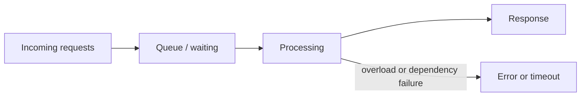

# Latency, Throughput, and Availability

These are different properties of a system. A design can improve one while making another worse, so state which one matters for the user-visible operation.

- **Latency:** how long one request takes, usually measured from the caller's point of view. Report percentiles such as p50, p95, and p99; a mean can hide slow requests.
- **Throughput:** how much work the system completes per unit time, such as requests per second or documents indexed per minute. State the workload and the error rate alongside it.
- **Availability:** the fraction of time a service can successfully serve requests under a stated definition and measurement window. A service-level objective (SLO) makes the target and measurement explicit.

## How they interact

When arrivals exceed processing capacity, requests queue. Queueing increases latency; eventually timeouts and errors can reduce successful throughput and availability. A slow dependency can have the same effect even when the API server itself is healthy. Measure end-to-end latency and important dependency spans, not just CPU utilization.

For a simple illustration, 99.9% availability over a 30-day month allows about 43 minutes of unavailable time. The actual error budget depends on the SLO window and how success is defined.

## AI engineering connection

For model serving, track time to first token and total response time separately for streamed responses, plus token throughput, request throughput, timeouts, and successful completion rate. A faster model may cost more; batching can improve throughput while increasing individual request latency. Retrieval and model calls need separate latency budgets.

## Practice

For an AI API, propose one metric and one target for each of latency, throughput, and availability. Define how a failed or partially generated answer is counted.

## References

- Martin Kleppmann, *Designing Data-Intensive Applications*, Chapter 1, “Describing Performance” and “Reliability.”
- [Hello Interview — Introduction](https://www.hellointerview.com/learn/system-design/in-a-hurry/introduction).
