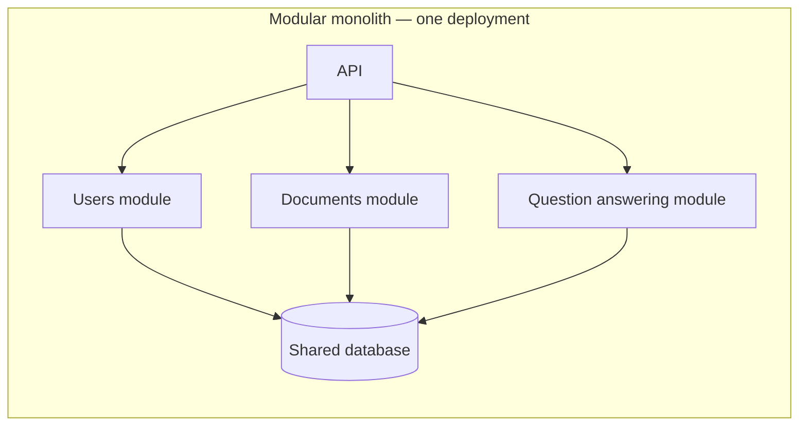
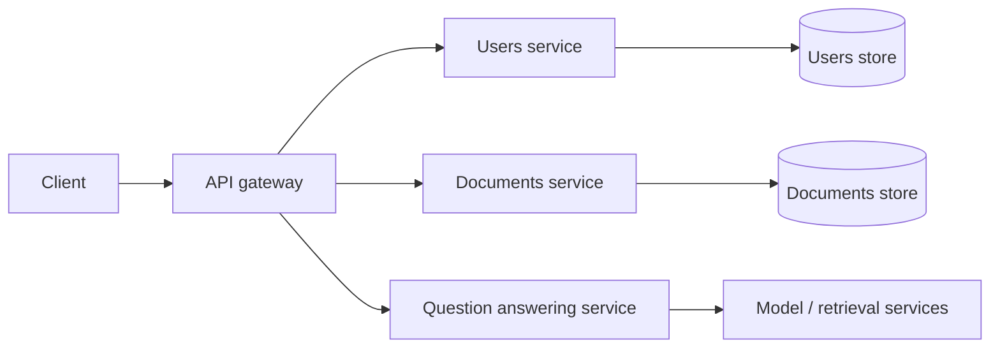

# Monolith vs. Microservices

A **monolith** is deployed as one application unit. A well-structured monolith can still have clear internal modules. **Microservices** split an application into separately deployable services that communicate over a network and often own their data.

## The tradeoff

| Modular monolith | Microservices |
|---|---|
| One deployable unit; simpler local calls and transactions | Services can deploy and scale independently |
| Easier to begin and operate with a small team | Clear service ownership can help larger teams work independently |
| A poorly modularized codebase can become tightly coupled | Network failures, partial failure, data consistency, deployment, and observability become part of the design |

Microservices do not automatically make a system scalable or maintainable. They move boundaries into the network, where every call can fail or be slow. They also create more operational work. A modular monolith is often a good starting point; split a service when a concrete need—such as independent scaling, release cadence, isolation, or team ownership—outweighs the added complexity.

## AI engineering connection

An AI product may combine document ingestion, retrieval, model inference, and evaluation. These can start as modules in one service. If model inference has a different hardware profile or release cadence, that may justify a separate service. Keep the decision tied to workload and ownership rather than using “AI” itself as a reason to create microservices.

## Practice

For a RAG application, list one reason to keep ingestion and query handling in one deployable service and one reason to split them. Include the network or data-consistency cost of the split.

## References

- Martin Kleppmann, *Designing Data-Intensive Applications*, Chapter 1, including the discussion of maintainability and microservices.
- [Hello Interview — Introduction](https://www.hellointerview.com/learn/system-design/in-a-hurry/introduction).
